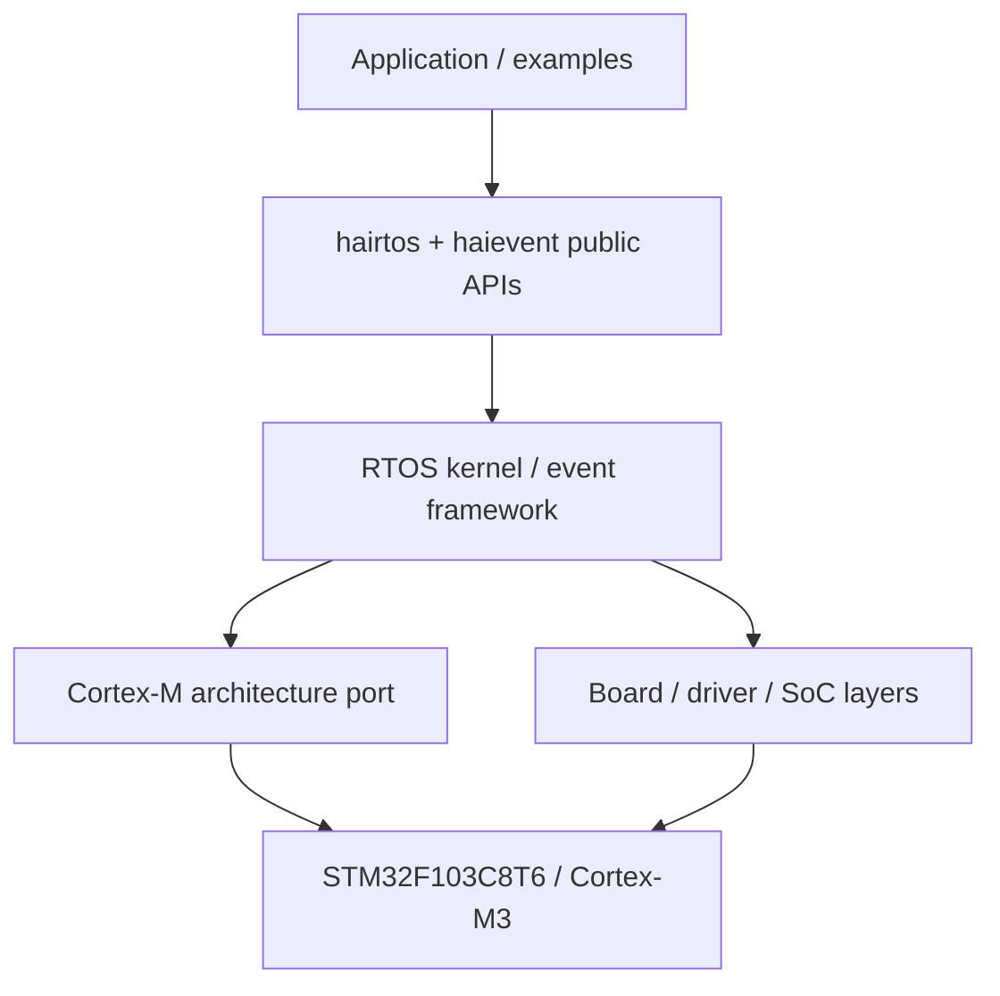

# hairtos

**A static-first, preemptive RTOS for ARM Cortex-M with an event-driven framework built on top of the kernel.**

[](https://github.com/haikevins/hairtos/actions/workflows/ci.yml)
[](VERSION)
[](CMakeLists.txt)
[](docs/04-platform/cortex-m3-port.md)
[](LICENSE)

`hairtos` is an educational and experimental systems project focused on the internals of a small real-time operating system: scheduling, blocking, synchronization, timeouts, Cortex-M context switching, diagnostics, and event-driven execution. The current reference target is the **STM32F103C8T6 Blue Pill / ARM Cortex-M3**.

The repository is organized like a real embedded systems codebase rather than a collection of isolated demos: public/internal boundaries are explicit, kernel objects use caller-owned static storage, target selection is manifest-driven, host validation runs under sanitizers, and architecture/platform code is separated from generic kernel policy.

> **Current source version:** `1.0.0`
>
> **Current implementation:** source + `docs/00`–`08`
>
> **Future design only:** `docs/09-version2/`

## At a Glance

- **Fixed-priority preemptive scheduler** with 8 priority levels and optional equal-priority round-robin.
- **Static-first task model** with caller-owned task objects and stacks; no general-purpose kernel heap.
- **Blocking IPC and synchronization**: queues, semaphores, normal/recursive mutexes, timeouts, suspend/resume.
- **Priority inheritance**, including chained inheritance and direct mutex handoff.
- **Software timers** dispatched from a timer-service task rather than from SysTick ISR context.
- **Cortex-M3 port** using SVC for first-task start and PendSV for context switching.
- **Diagnostics** with stack guards/high-watermark, runtime counters, panic records, and retained fault context.
- **`haievent` framework** with Active Objects, flat state machines, time events, fixed-block dynamic events, and publish/subscribe.
- **Host validation** with GCC, AddressSanitizer, UndefinedBehaviorSanitizer, deterministic tests, and scheduler stress workloads.

## Architecture



The main ownership boundaries are:

- **Application** code consumes `hairtos/hairtos.h`, `haievent/haievent.h`, and `board.h`.
- **Kernel internals** own scheduler policy, ready/wait/timeout lists, blocking and wake-up protocols, and object invariants.
- **Architecture port** owns PSP/MSP handling, SVC, PendSV, critical sections, exception entry/return, and context save/restore.
- **Board / driver / SoC** layers isolate target-specific clocks, startup, registers, pins, debug markers, UART, and LEDs.
- **Target manifest** selects the architecture, SoC, board, drivers, linker configuration, and example sources used by CMake.

Detailed architecture and context-switch documentation lives under [`docs/`](docs/README.md).

## Kernel Capabilities

### Scheduling and tasks

- Fixed-priority preemptive scheduling; **lower numeric values mean higher priority**.
- 8 priority levels; idle runs at priority 7.
- One intrusive FIFO ready queue per priority plus a bitmap of non-empty priorities.
- Optional equal-priority round-robin when `HR_CFG_TIME_SLICING=1`; default slice is 1 tick.
- Task states: CREATED, READY, RUNNING, BLOCKED, SUSPENDED.
- Separate base/effective priorities for priority inheritance.

### Time, IPC, and synchronization

- `uint32_t` tick counter; default tick frequency is 1 kHz.
- Dual sorted timeout lists handle tick wrap-around.
- FIFO queues with blocking send/receive, timeout, direct handoff, and ISR-safe non-blocking APIs.
- Binary/counting semaphores with ISR give support.
- Normal and recursive mutexes with ownership, chained priority inheritance, and direct handoff.
- Software-timer callbacks run in task context through the timer-service task.

### Diagnostics

- Stack fill pattern, stack guard, and high-watermark tracking.
- Runtime counters and health reports.
- Panic/fault records retained in `.noinit` for post-reset inspection.
- Fault context captures stacked registers and Cortex-M fault status registers.

## `haievent`

`haievent` is an event-driven framework layered on top of the kernel rather than a separate scheduler.

It currently provides:

- static events and dynamic events from a fixed-block pool;
- reference counting for dynamic event ownership;
- flat state machines with ENTRY/EXIT/INIT/TIMEOUT signals;
- Active Object = task + queue + state machine;
- time events backed by software timers;
- publish/subscribe through a static subscriber table;
- posting from task and ISR context.

Current v1 scope intentionally excludes HSMs, deferred events, history states, and a shared-executor AO model. Those ideas belong to [`docs/09-version2/`](docs/09-version2/README.md), not the current runtime.

## Reference Target

Current complete target: `bluepill_f103c8`.

| Attribute | Current binding |
| --- | --- |
| MCU | STM32F103C8T6 |
| CPU | ARM Cortex-M3 |
| Clock | Nominal 72 MHz, HSE 8 MHz → PLL ×9, with HSI fallback |
| UART | USART1 PA9/PA10, 115200 8-N-1 |
| LED | PC13 active-low |
| Kernel tick | SysTick, 1 kHz |
| First task / context switch | SVC / PendSV |
| Benchmark clock | DWT CYCCNT |
| Benchmark marker | PB0 active-high |
| Debug | ST-Link + SWD + OpenOCD/GDB |

See [`docs/04-platform/`](docs/04-platform/README.md) for the port contract, Cortex-M3 implementation, STM32F103 platform, startup/linker details, and target-porting guide.

## Build and Run

### Prerequisites

For host validation:

- CMake
- Ninja
- GCC

For target build/debug additionally:

- Arm GNU Toolchain (`arm-none-eabi-*`)
- OpenOCD
- ST-Link compatible debug probe
- STM32F103C8T6 Blue Pill or compatible target

The Makefile is a command wrapper; **CMake is the source of truth** for target, example, module, and source selection.

```bash
make help
make list-targets
make list-examples
```

### Host validation

```bash
make TARGET=bluepill_f103c8 host-tests
```

Run representative host examples:

```bash
make TARGET=bluepill_f103c8 \
  ENVIRONMENT=host \
  EXAMPLE=02-kernel-data-structures-host \
  run

make TARGET=bluepill_f103c8 \
  ENVIRONMENT=host \
  EXAMPLE=14-memory-allocator-lab \
  run

make TARGET=bluepill_f103c8 \
  ENVIRONMENT=host \
  EXAMPLE=16-diagnostics-stress-stabilization \
  run
```

### Target build

```bash
make TARGET=bluepill_f103c8 \
  EXAMPLE=16-diagnostics-stress-stabilization \
  build
```

Flash with OpenOCD:

```bash
make TARGET=bluepill_f103c8 \
  EXAMPLE=16-diagnostics-stress-stabilization \
  flash
```

Debug with GDB/OpenOCD:

```bash
make TARGET=bluepill_f103c8 \
  EXAMPLE=16-diagnostics-stress-stabilization \
  debug-server
```

In another terminal:

```bash
make TARGET=bluepill_f103c8 \
  EXAMPLE=16-diagnostics-stress-stabilization \
  gdb
```

## Verification

The repository's CI currently validates reproducible **host-side** behavior. Target cross-build and physical-board execution are separate evidence and should not be inferred from host CI.

| Validation | Current baseline |
| --- | --- |
| GitHub Actions host validation | PASS |
| GCC strict host build | PASS |
| AddressSanitizer / UBSan | PASS |
| `ctest` | PASS, 1/1 test target |
| Host test functions | 64 |
| Example 02 host | PASS |
| Example 14 allocator host | PASS |
| Example 16 scheduler stress host | PASS |
| Stress iterations | 500,000 |
| ARM target cross-build | Requires ARM GNU toolchain |
| Physical hardware validation | Requires Blue Pill + debug probe |

The detailed validation baseline and its interpretation are documented in [`docs/06-testing-and-quality/validation-baseline.md`](docs/06-testing-and-quality/validation-baseline.md).

> Host sanitizer results are evidence for the exercised generic C paths. They do **not** establish interrupt latency, WCET, electrical behavior, target startup correctness, or retained-fault behavior across physical resets.

## Examples

The examples are incremental demonstrations and verification workloads for the RTOS; they are not the architecture of the project itself.

| Stage | Examples | Focus |
| --- | --- | --- |
| Bare-metal baseline | 01 | board / UART / LED / tick |
| Kernel structures | 02 | intrusive list, ready set, wait list |
| Task bootstrap | 03–05 | TCB, stack frame, SVC, PendSV |
| Scheduling and time | 06–08 | priority, delay, preemption, round-robin |
| IPC and synchronization | 09–12 | queue, semaphore, mutex PI, suspend/resume, timer |
| Event-driven framework | 13-01…13-06 | events, AO, FSM, time event, pub-sub, integration |
| Experiments and evidence | 14–16 | allocator, benchmark, diagnostics/stress |

See [`examples/README.md`](examples/README.md) for the full sequence.

## Repository Layout

```text
hairtos/
├── arch/                     # architecture-specific context/critical/fault/benchmark
├── benchmarks/kernel/        # generic benchmark statistics
├── boards/                   # board binding, linker, marker/UART/LED services
├── cmake/                    # target/module/example source-of-truth
├── config/                   # compile-time kernel + haievent policy
├── docs/                     # v1 technical docs + explicit v2 roadmap
├── drivers/                  # public peripheral contracts + STM32F1 backend
├── examples/                 # demonstrations and verification workloads
├── haievent/                 # event-driven framework
├── kernel/                   # public/internal RTOS kernel
├── labs/memory-allocator/    # allocator experiment outside kernel runtime
├── soc/                      # STM32F1 startup/clock/IRQ/register layer
├── tests/                    # host, mocks, portability probes, stress
└── tools/                    # OpenOCD/GDB helpers
```

## Documentation

Start with [`docs/README.md`](docs/README.md), then follow the area relevant to your goal:

| Area | Documentation |
| --- | --- |
| Architecture and design principles | [`docs/00-overview/`](docs/00-overview/README.md) |
| Scheduler, task model, context switch, timeout | [`docs/01-kernel-core/`](docs/01-kernel-core/README.md) |
| Queue, semaphore, mutex, timer | [`docs/02-synchronization/`](docs/02-synchronization/README.md) |
| `haievent` internals | [`docs/03-haievent/`](docs/03-haievent/README.md) |
| Cortex-M3 / STM32F103 / porting | [`docs/04-platform/`](docs/04-platform/README.md) |
| Public API reference | [`docs/05-api-reference/`](docs/05-api-reference/README.md) |
| Testing, diagnostics, benchmark, release | [`docs/06-testing-and-quality/`](docs/06-testing-and-quality/README.md) |
| Examples and allocator lab | [`docs/07-labs-and-examples/`](docs/07-labs-and-examples/README.md) |
| Glossary, source map, limitations | [`docs/08-appendices/`](docs/08-appendices/README.md) |
| Version 2 proposals — future only | [`docs/09-version2/`](docs/09-version2/README.md) |

## Current v1 Limitations

- single-core only;
- no FPU context management or MPU isolation;
- Cortex-M3 critical sections use PRIMASK; no BASEPRI-based application interrupt ceiling yet;
- no tickless idle;
- no general-purpose dynamic kernel heap;
- `haievent` currently provides a flat FSM and one task per Active Object;
- the only complete target currently provided is STM32F103C8T6 Blue Pill;
- benchmark results are engineering evidence, not hard real-time certification.

## Project Status

`hairtos` is currently an **educational/experimental RTOS**, not a safety-certified or production-qualified kernel. The project intentionally keeps roadmap material separate from implemented behavior so that documentation does not overstate runtime capability.

Release history is tracked in [`CHANGELOG.md`](CHANGELOG.md).

## License

MIT — see [`LICENSE`](LICENSE).

## References

Primary technical references used by the project include:

- [Arm Cortex-M3 Technical Reference Manual](https://developer.arm.com/documentation/100165/latest/)
- [Arm Cortex-M3 Devices Generic User Guide](https://developer.arm.com/documentation/dui0552/latest/)
- [ST RM0008 — STM32F101/102/103/105/107 Reference Manual](https://www.st.com/resource/en/reference_manual/cd00171190-stm32f101xx-stm32f102xx-stm32f103xx-stm32f105xx-and-stm32f107xx-advanced-arm-based-32-bit-mcus-stmicroelectronics.pdf)
- [STM32F103 documentation](https://www.st.com/en/microcontrollers-microprocessors/stm32f103/documentation.html)
- [CMake toolchain files](https://cmake.org/cmake/help/latest/manual/cmake-toolchains.7.html)
- [OpenOCD User's Guide](https://openocd.org/doc/html/index.html)
